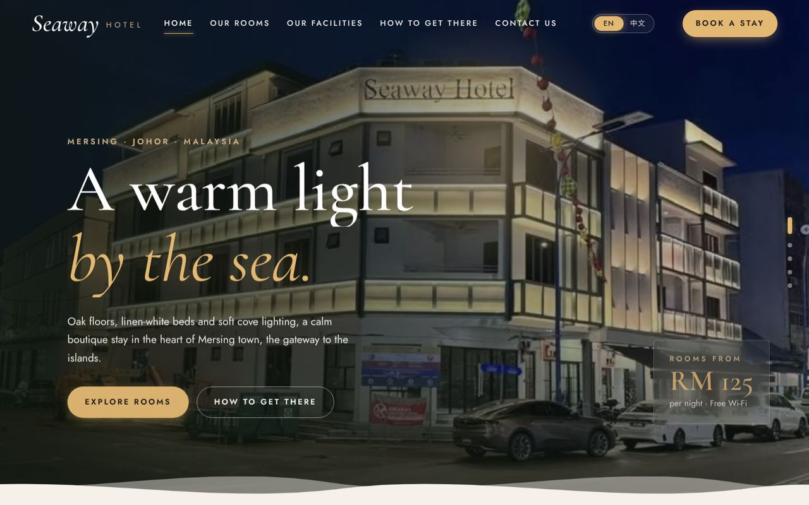
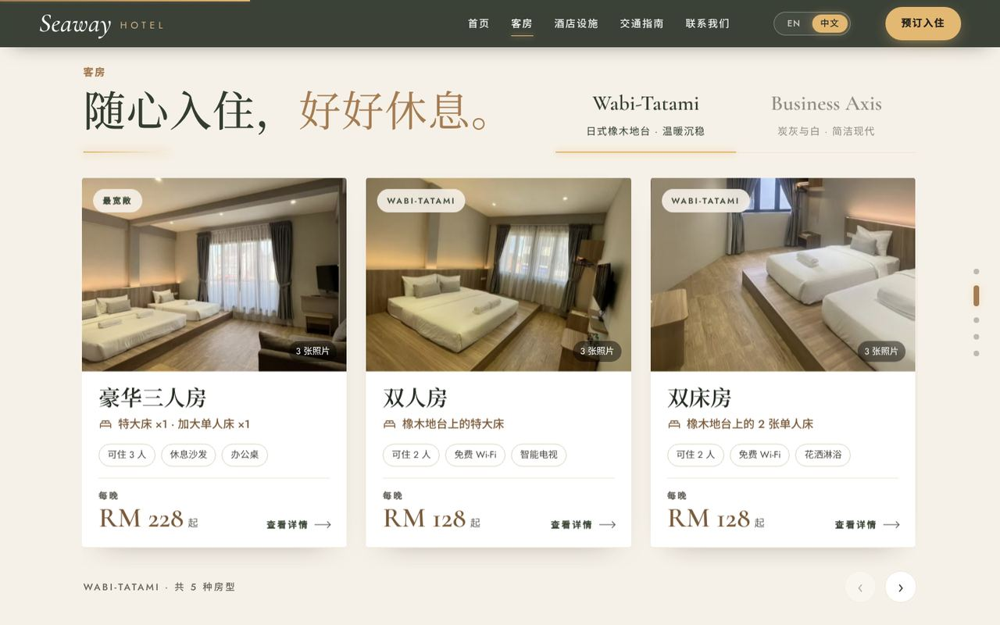
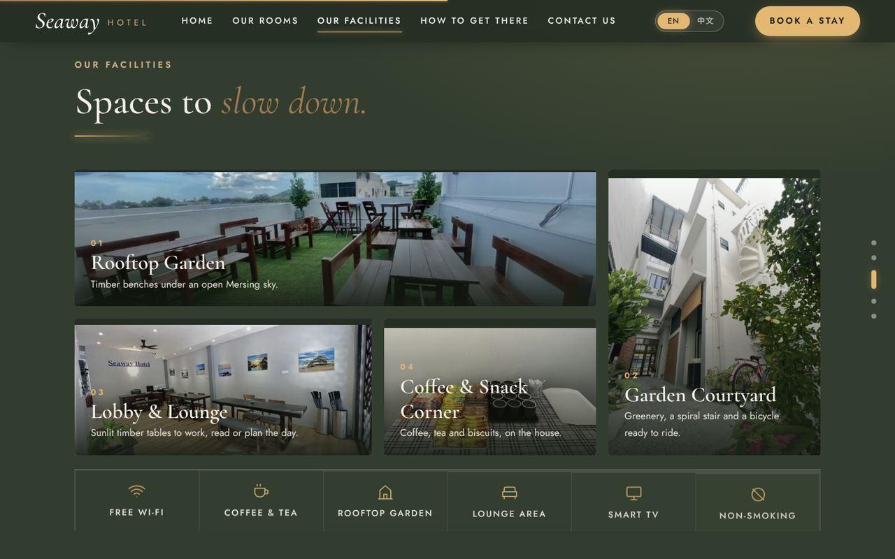
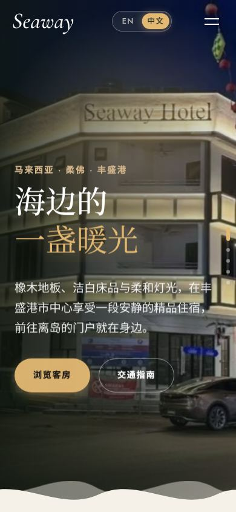

# Seaway Hotel

A bilingual (English / 中文) website for **Seaway Hotel**, a boutique hotel at 11, Jalan Abu Bakar, Mersing, Johor, Malaysia. Built with React and Vite, pre-rendered for search engines, and hosted on Cloudflare.

**Live site:** [xinhuidemo.tech](https://xinhuidemo.tech) · 中文版：[xinhuidemo.tech/zh/](https://xinhuidemo.tech/zh/)



> **中文简介**
> Seaway Hotel（丰盛港）的中英双语酒店官网。网站分五屏：首页、客房、设施、交通指南、联系我们。电脑上滚一下就翻一整屏，手机上正常滑动。客房分 Wabi-Tatami 和 Business Axis 两翼，点开可看照片和价钱。交通指南会显示丰盛港现在的时间和还要多久可以入住，并可一键打开 Google Maps 或 Waze 导航。网站用 React + Vite 开发，构建时会把中英文页面的文字预先写进 HTML，方便 Google 收录，部署在 Cloudflare。

## Features

- **Five full-screen sections:** Home, Rooms, Facilities, How to Get There, Contact. On desktop, one wheel notch, swipe or arrow key moves exactly one screen. Phones and small windows scroll normally.
- **English and Chinese:** a toggle in the navbar switches language. English lives at `/`, Chinese at `/zh/`, and visitors whose browser prefers Chinese are sent to `/zh/` automatically.
- **Rooms:** 20 rooms across the Wabi-Tatami and Business Axis wings, shown as a slider of cards with prices from RM128. Each card opens a detail view with a photo gallery and an "Enquire" button that fills in the contact form.
- **Facilities:** rooftop garden, courtyard, lobby and coffee corner, with a full-size photo viewer.
- **How to Get There:** the address with one-tap copy, a live "Mersing time now / check-in opens in…" badge, Google Maps and Waze buttons, and an embedded map.
- **Contact:** an enquiry form with validation, plus phone, email and social links.
- **Details:** opening preloader, scroll progress bar, page dots, entrance animations, and reduced motion for visitors who ask for it.

| Rooms (中文)                                       | Facilities                                        | Phone                                                    |
| -------------------------------------------------- | ------------------------------------------------- | -------------------------------------------------------- |
|  |  |  |

## SEO

- Each language is pre-rendered to its own HTML file at build time, so search engines read the full text without running JavaScript.
- Page titles and descriptions per language, canonical and `hreflang` links between `/` and `/zh/`.
- Schema.org `Hotel` data: address, check-in 15:00, check-out 12:00, price range, amenities and room offers.
- Open Graph and Twitter preview cards, favicon and Apple touch icon.
- `sitemap.xml` and `robots.txt` generated on every build.

## Tech stack

| Part          | Choice                                                                                           |
| ------------- | ------------------------------------------------------------------------------------------------ |
| UI            | React 18                                                                                         |
| Build         | Vite 6                                                                                           |
| Pre-rendering | `react-dom/server` via `scripts/prerender.mjs`                                                   |
| Styling       | Plain CSS (`src/styles/global.css`), fonts Cormorant Garamond, Jost, Noto Serif SC, Noto Sans SC |
| Hosting       | Cloudflare Workers static assets, auto-deployed from GitHub                                      |

No UI framework or router is used; the whole site is one page with a language-aware URL.

## Project structure

```
index.html                 HTML template (head tags, fonts, icons)
scripts/prerender.mjs      Renders / and /zh/ to static HTML after vite build
public/                    Photos, favicon, share image
src/
  main.jsx                 Picks the language from the URL and hydrates the page
  entry-server.jsx         Server render entry used by the pre-render script
  App.jsx                  Page layout, preloader and full-page paging
  components/              One component per section (Hero, Rooms, Facilities, Location, Contact…)
  data/
    rooms.js               Room types, beds, prices, photos
    facilities.js          Facilities, amenities, address, contact details
    site.js                Site URL, search titles and descriptions, Hotel schema
  hooks/                   Full-page paging, scroll reveal, reduced motion
  i18n/                    Language context and UI strings (EN / 中文)
  styles/global.css        All styles; colours and fonts are variables at the top
```
